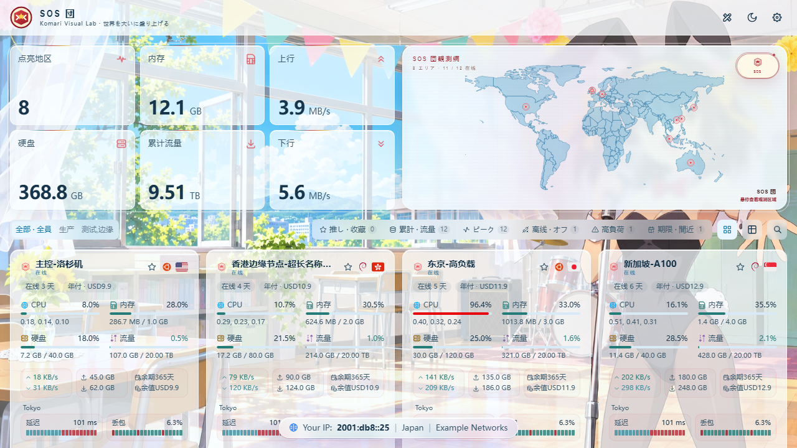

# 凉宫春日 SOS 团 · Komari 主题

一套以经典日漫《凉宫春日的忧郁》与 SOS 团活动室为视觉主题的 Komari Monitor 前端。工程基于 `komari-theme-Bocchi` 的完整监控能力重新设计，保留节点卡片、列表、世界地图、详情图表、管理员工具、权限校验、移动端布局和 Komari 主题 zip 打包。



## 视觉特色

- 晴空蓝、暖白、柠檬黄与 SOS 团袖章红，表现晴天校园祭的轻快青春感。
- 内置晴天兔女郎凉宫春日桌面横图和手机竖图：蓝天白云、飘动窗帘、彩色拉旗和洒满阳光的活动室。
- 服务器卡片使用单层磨砂玻璃：明亮模式约 72% 不透明度，夜间约 78%，5px 轻磨砂，保留适量背景轮廓；地图约 90% 不透明度，边界和节点亮点更清楚。
- 默认使用明亮模式，夜间为通透的蓝色玻璃，保留背景亮度。已有站点若仍为夜间，可在右上角切到明亮，或在后台将默认主题模式设为 `light`。
- 独立 SOS 六边形徽记，用于页签图标、站点头像、节点在线状态和地图彩蛋。
- 节点随机显示《God knows...》《ハレ晴レユカイ》《冒険でしょでしょ？》等系列曲目标签。
- 点击左上角 SOS 徽章或地图右上角 `SOS` 信号按钮可打开两种全屏彩蛋。
- 明亮 / 夜间模式、桌面 / 手机布局与自定义图片或视频背景均可配置。

## 安装

推荐在 Komari 后台「外观与插件 → 主题管理 → 导入主题」填写仓库地址：

```text
https://github.com/BassYes/komari-theme-Haruhi-SOS
```

点击检查并确认导入。Komari 会从最新正式 Release 下载主题安装包，无需浏览器上传 ZIP。

也可从 [Releases](https://github.com/BassYes/komari-theme-Haruhi-SOS/releases/latest) 下载 ZIP 手动上传。主题内部标识为 `haruhi-sos`。

从源码构建：

1. 在本目录运行 `pnpm install`。
2. 运行 `pnpm run build`。
3. 在 Komari 后台上传根目录生成的 `komari-theme-Haruhi-SOS-v*.zip`。
4. 启用 `Haruhi SOS` 主题。

zip 内固定包含：

```text
komari-theme.json
preview.png
dist/
```

## 本地开发

```bash
pnpm install
pnpm run dev
pnpm run build
pnpm run test:visual
```

开发与 CI 使用 Node.js 24、pnpm 10.28.1 和仓库中的 `pnpm-lock.yaml`。`publish` 与 `sync:admin` 是继承的辅助脚本，单独运行它们时仍需 Bun；常规开发、构建和测试无需 Bun。

发布新版本：更新 `komari-theme.json` 中的版本并提交，再推送对应的 `vX.Y.Z` 标签。GitHub Actions 会构建并发布唯一的主题 ZIP 附件。

默认开发代理指向 `http://127.0.0.1:25774`。需要连接其他 Komari 实例时，可设置 `VITE_API_TARGET`。

HTTP 与 WebSocket RPC 默认使用 `/api/rpc2`，无需额外 `.env` 文件。特殊部署可用 `VITE_API_BASE` 覆盖 API 前缀。

## 主题设置

- `themeMode`：北京时间自动、明亮或夜间模式。
- `fanLabelsEnabled`：节点是否显示系列曲目标签。
- `fanAudioPreviewEnabled`：是否启用管理员自备授权音频的悬停试听。
- `gloriaHeroUrl`：替换地图按钮打开的彩蛋素材。
- `easterMapSlogan` / `easterAvatarSlogan`：两种彩蛋的中心文案。
- `glassColorPreset`：推荐使用 `SOS团`，也可切换通用预设或自定义 JSON。
- `backgroundEnabled`：开启后用管理员配置的图片或视频替换内置背景。

音频不会随主题附带，也不会自动下载。若配置试听，请只使用已获授权的 20–30 秒片段。

## 内置素材

```text
public/images/sos/haruhi-youth-desktop.webp
public/images/sos/haruhi-youth-mobile.webp
public/images/sos/sos-badge.svg
```

两张凉宫春日背景由 OpenAI 内置 ImageGen 为本主题生成，原始提示词见项目交接记录。它们用于粉丝向、非官方主题展示；角色及作品相关权利归原权利方所有。请勿将本主题或素材描述为官方授权产品。

## 致谢与许可

- 数据与监控能力基于 [Komari Monitor](https://github.com/komari-monitor/komari)。
- 工程基础来自 `komari-theme-Bocchi` / `komari-theme-Glassmorphism`，原项目采用 MIT License。
- 本仓库继续保留原 `LICENSE`。二次分发时请同时保留原作者署名与许可证文本。

这是非官方粉丝主题，与《凉宫春日的忧郁》版权方无隶属或背书关系。
